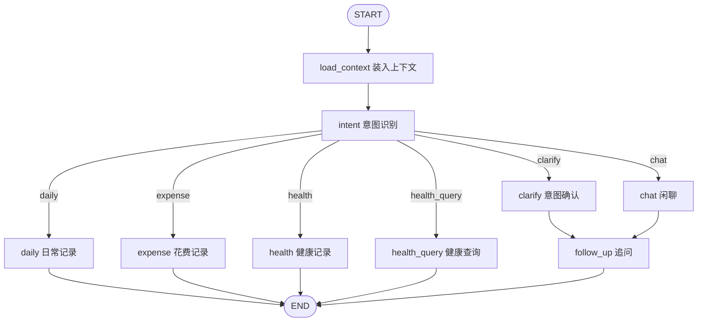

# assistant-langgraph

[English](README.md)

基于 Spring Boot 的助手示例。它用 Spring AI 调用 DeepSeek，并用 LangGraph4j 跑一条可流式返回的简单工作流。

这是一个最小可运行的后端，用来演示两件事：

- 通过 HTTP 调用 DeepSeek 聊天模型，支持一次返回和流式返回。
- 用 LangGraph4j 把 `greeter` 和 `responder` 串成工作流，并按节点用 SSE 推送结果。

工作流路径是 `START → greeter → responder → END`。`greeter` 追加问候，`responder` 看到问候后追加确认。

## 技术栈

| 组件 | 版本 |
| --- | --- |
| Java | 17 |
| Spring Boot | 4.0.8 |
| Spring AI | 2.0.1 |
| LangGraph4j | 1.9.2 |

Spring AI 2.x 需要 Spring Boot 4.x。项目额外引入了 `spring-boot-starter`，因为 Boot 4 的 `spring-boot-starter-web` 不再附带 SnakeYAML，否则 `application.yaml` 不会被加载。

## 启动

仓库里的 `src/main/resources/application.yaml` 只保留占位符 `api-key: ${DEEPSEEK_API_KEY:}`，不包含真实密钥。任选一种方式提供密钥：

1. 复制示例文件并填入自己的密钥。这个文件已被 `.gitignore` 忽略，不会进入提交。

```bash
copy config\application.yaml.example config\application.yaml
```

2. 设置环境变量 `DEEPSEEK_API_KEY`。环境变量的优先级高于 `config/application.yaml`。改完后需要在新的终端或运行配置里启动，当前已经打开的终端不会自动读到新值。

当前 PowerShell 窗口有效，关闭后失效：

```powershell
$env:DEEPSEEK_API_KEY = "你的密钥"
mvn spring-boot:run
```

当前 cmd 窗口有效，关闭后失效：

```bat
set DEEPSEEK_API_KEY=你的密钥
mvn spring-boot:run
```

写入当前 Windows 用户，之后新开的终端都会带上。这条命令不会改变当前窗口，需要重新打开终端：

```powershell
setx DEEPSEEK_API_KEY "你的密钥"
```

Linux / macOS 当前终端有效：

```bash
export DEEPSEEK_API_KEY=你的密钥
mvn spring-boot:run
```

在 IntelliJ IDEA 中运行时，打开 Run/Debug Configurations，在 Environment variables 里添加 `DEEPSEEK_API_KEY=你的密钥`。

Spring Boot 会用项目根目录的 `config/application.yaml` 覆盖仓库配置。本地文件和环境变量至少配置一种，然后启动：

```bash
mvn spring-boot:run
```

默认端口是 `8080`。

## 接口

| 方法 | 路径 | 说明 |
| --- | --- | --- |
| GET | `/ai/generate?message=` | 调用 DeepSeek，一次返回结果 |
| GET | `/ai/generateStream?message=` | 调用 DeepSeek，流式返回 |
| GET | `/ai/graph/run?message=` | 执行问候工作流，`text/event-stream`，每个节点一条事件 |
| GET | `/ai/pet/chat?message=&sessionId=` | 执行养宠助手，`text/event-stream`，每个节点一条事件 |
| GET | `/ai/pet/cancel?chatId=` | 取消这一次 SSE，对话记忆保留 |

工作流示例：

```bash
curl -N "http://localhost:8080/ai/graph/run?message=Let's,%20begin!"
```

每条事件包含当前节点名，以及该步结束时的消息快照：

```text
data:{"node":"greeter","messages":["Let's, begin!","Hello from GreeterNode!"]}
```

不传 `message` 时，聊天接口默认是 `Tell me a joke`，问候工作流默认是 `Let's, begin!`。

## 养宠助手

`GET /ai/pet/chat?message=&sessionId=` 以 `text/event-stream` 执行养宠助手。空白 `message` 返回 400。省略 `message` 时默认为 `你好`。省略 `sessionId` 会新建一段对话，每条 SSE 事件都会带回该标识，下次请求原样传入即可继续。`sessionId` 表示养宠助手这一段对话，不是登录态。每一次请求还会生成独立的 `chatId`。服务节点目前返回调试文案。宠物档案和病例摘要是进程内 mock 数据。

先进入 `load_context` 装入会话与档案，再进入 `intent` 识别意图。日常记录、花费记录、健康记录、健康查询做完即结束。闲聊和意图确认进入 `follow_up` 追问。



「皮皮今天吐了一点白色的液体」会走到 `clarify`，再由 `follow_up` 追问是要记下，还是想问问要不要就医。下一轮带上返回的 `sessionId`，发送「帮我记一下」，会进入 `health`。

```bash
curl -N "http://localhost:8080/ai/pet/chat?message=皮皮今天吐了一点白色的液体"
curl -N "http://localhost:8080/ai/pet/chat?message=帮我记一下&sessionId=粘贴上一步返回的sessionId"
curl "http://localhost:8080/ai/pet/cancel?chatId=粘贴本次返回的chatId"
```

`sessionId` 表示养宠助手这一段对话，不是登录态。`chatId` 表示这一次 SSE。取消时带 `chatId`。这段对话和已完成的内容都保留，输入框下一次发送继续带同一个 `sessionId`。前端直接断开 SSE 连接，效果相同。

每条事件包含节点名、`sessionId`、`chatId`、识别出的意图，以及该步结束时的消息快照。
